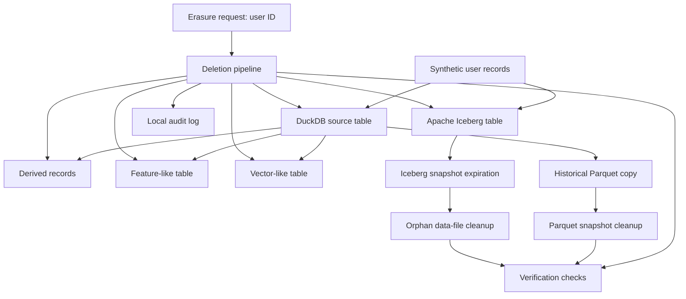

# Lakehouse Erasure Lab

A reproducible prototype exploring how a data platform can respond to user-erasure requests across source data, derived data, feature-like tables, vector-like records, and historical data copies.

The project demonstrates a local erasure workflow using **DuckDB, Apache Iceberg, and Parquet**.

## Project status

**Implemented:**
- Synthetic user-data generation.
- DuckDB source, derived, feature-like, and vector-like tables.
- A local Apache Iceberg table integrated with the pipeline.
- User deletion from current DuckDB and Iceberg table state.
- Historical Parquet-copy cleanup.
- Iceberg snapshot expiration and local orphan data-file cleanup.
- Verification checks across current tables and remaining historical files.
- Local deletion audit logging.
- Automated tests and a benchmark results notebook.

**Not implemented:**
- External production feature stores or vector databases.
- Cloud object-storage deletion.
- Automated deletion propagation to downstream services.
- Backup and replica erasure.
- Production identity, authorization, and request-management infrastructure.
- End-to-end regulatory compliance certification.

## Architecture



The feature-like and vector-like components are simulated using DuckDB tables. Apache Iceberg is integrated as a local table using a SQLite catalog and Parquet data files.

The prototype separates two important operations:

1. **Current-state deletion:** removes the target user's records from the active DuckDB and Iceberg tables.
2. **Historical cleanup:** removes registered historical Parquet copies and expires older Iceberg snapshots, followed by cleanup of unreferenced data files in the dedicated local demo table.

DuckDB and Iceberg do not share a distributed transaction. The pipeline reports Iceberg errors separately rather than claiming that both systems participate in one atomic transaction.

See [Architecture](docs/architecture.md) for more details.

## Requirements

- Python 3.10 or compatible Python version.
- Git.
- Dependencies listed in `requirements.txt`.
- PyIceberg and PyArrow for the Iceberg integration.
- Windows, macOS, or Linux.

## Setup

From the repository root, create and activate a virtual environment.

**Windows CMD:**

```cmd
python -m venv .venv
.venv\Scripts\activate
python -m pip install --upgrade pip
pip install -r requirements.txt
pip install pyiceberg pyarrow
```

**macOS/Linux:**

```bash
python -m venv .venv
source .venv/bin/activate
python -m pip install --upgrade pip
pip install -r requirements.txt
pip install pyiceberg pyarrow
```

## Run the pipeline

From the repository root:

```bash
python -m src.erasure.pipeline
```

The demonstration:
1. Generates synthetic user records.
2. Loads records into the DuckDB stores.
3. Synchronizes user records into the local Iceberg table.
4. Deletes a selected user from current DuckDB and Iceberg state.
5. Expires historical snapshots and cleans up eligible local files.
6. Verifies that the selected user is absent from the checked stores and historical files.

The default demonstration deletes user `U000007`.

## Run tests

```bash
python -m pytest -v
```

The current test suite contains four tests covering:

- Deletion from all simulated current-state stores.
- Historical-copy cleanup.
- Rejection of empty user IDs.
- Idempotent repeated deletion.

These tests validate the behaviors covered by the local test suite; they do not establish production-wide erasure guarantees.

## Run the benchmark

```bash
python scripts/benchmark.py
```

Review generated results in:

- `results/scale_benchmark.csv`
- `results/benchmark_summary.csv`

The benchmark notebook is `notebooks/results.ipynb`; `notebooks/results_executed.ipynb` contains a saved execution.

### Recorded benchmark results

Previously recorded local baseline measurements using three repeats per dataset size:

| Synthetic records | Mean deletion latency | Verified runs |
|---:|---:|---:|
| 100 | 46.793 ms | 3/3 |
| 1,000 | 48.284 ms | 3/3 |
| 5,000 | 58.759 ms | 3/3 |
| 10,000 | 59.477 ms | 3/3 |

All 12 recorded runs passed the pipeline's verification check.

**Benchmark qualification:** These are previously recorded local prototype measurements, not production performance guarantees or a benchmark of distributed Iceberg deployments. Re-run the benchmark against the current code before presenting these figures as measurements of the integrated implementation.

## Repository map

```text
lakehouse-erasure-lab/
├── src/
│   └── erasure/
│       ├── pipeline.py
│       └── iceberg_store.py
├── tests/
│   └── test_pipeline.py
├── scripts/
│   └── benchmark.py
├── notebooks/
│   ├── results.ipynb
│   └── results_executed.ipynb
├── docs/
│   ├── architecture.md
│   └── data-card.md
├── reports/
│   └── technical-report.md
├── data/
│   ├── raw/
│   └── processed/
├── results/
├── requirements.txt
└── README.md
```

### Main components

- `src/erasure/pipeline.py` — coordinates data generation, deletion, historical cleanup, and verification.
- `src/erasure/iceberg_store.py` — manages the local Iceberg catalog, table operations, snapshot expiration, and storage verification.
- `tests/test_pipeline.py` — automated tests.
- `scripts/benchmark.py` — local scale benchmark.
- `notebooks/results.ipynb` — results analysis notebook.
- `docs/architecture.md` — system design and limitations.
- `docs/data-card.md` — dataset description and intended use.
- `reports/technical-report.md` — technical evaluation.

## Limitations and responsible use

This project is an educational prototype, not a production erasure service.

Passing the tests establishes behavior for the tested local synthetic data only. It does not prove deletion from:

- Backups and replicas.
- Logs and audit systems.
- Downstream consumers.
- External feature stores or vector databases.
- Cloud object-storage versions.
- Independently retained copies.

The local Iceberg cleanup implementation is designed for this dedicated demonstration table. Production file cleanup requires stronger coordination, retention policies, concurrency protection, and safeguards against deleting files still needed by active snapshots or readers.

The prototype does not provide legal certification or demonstrate GDPR or DPDP compliance.

A production implementation would need identity and authorization controls, durable request tracking, retries, distributed deletion coordination, backup handling, downstream propagation, independent verification, retention policies, and security review.

## License and data

No real personal data is required for the benchmark. Add a license and any institutional attribution required by your course before public release.