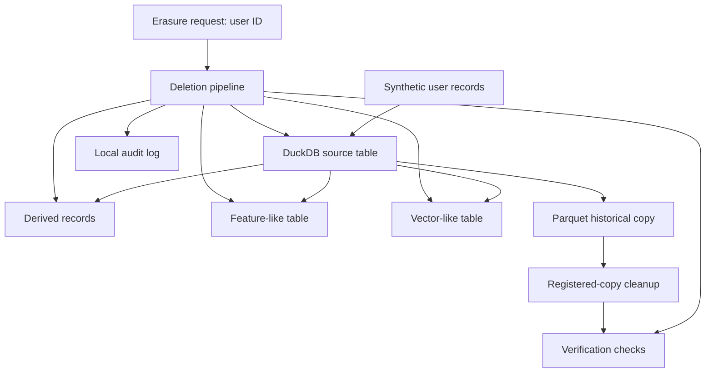

# Lakehouse Erasure Lab

A reproducible prototype exploring how a data platform can respond to user-erasure requests across source data, derived data, feature-like tables, vector-like records, and historical Parquet copies.

## Project status

**Implemented:** synthetic-data pipeline using DuckDB and Parquet, user-deletion workflow, verification checks, snapshot-copy cleanup, audit logging, automated tests, and a benchmark results notebook.

**Not yet implemented:** native Apache Iceberg tables and snapshot expiration, external production feature stores, external vector databases, cloud-storage deletion, and end-to-end regulatory compliance.

## Architecture



The feature-like and vector-like components are simulated using DuckDB tables. The Parquet file is a historical copy, not an Iceberg-managed snapshot.

See [Architecture](docs/architecture.md) for details.

## Requirements

- Python 3.10 or compatible Python version
- Dependencies listed in `requirements.txt`
- Windows, macOS, or Linux

## Setup

From the repository root:

```powershell
python -m venv .venv
.\.venv\Scripts\Activate.ps1
python -m pip install --upgrade pip
pip install -r requirements.txt
```

For macOS/Linux activation, use `source .venv/bin/activate`.

## Run tests

```powershell
python -m pytest -v
```

The current test suite contains four tests covering deletion from simulated stores, historical-copy cleanup, invalid empty user IDs, and repeated deletion.

## Run the benchmark

```powershell
python scripts/benchmark.py
```

Review the generated results in `results/scale_benchmark.csv` and `results/benchmark_summary.csv`. The benchmark notebook is `notebooks/results.ipynb`; `notebooks/results_executed.ipynb` contains a saved execution.

## Benchmark results

Recorded local results using three repeats per dataset size:

| Synthetic records | Mean deletion latency | Verified runs |
|---:|---:|---:|
| 100 | 46.793 ms | 3/3 |
| 1,000 | 48.284 ms | 3/3 |
| 5,000 | 58.759 ms | 3/3 |
| 10,000 | 59.477 ms | 3/3 |

All 12 recorded runs passed the pipeline's verification check. These are local prototype measurements, not production performance guarantees.

## Repository map

- `src/erasure/pipeline.py` — deletion pipeline and verification logic
- `tests/test_pipeline.py` — automated tests
- `scripts/benchmark.py` — scale benchmark
- `notebooks/results.ipynb` — results analysis notebook
- `results/` — benchmark data, summary, and chart
- `docs/architecture.md` — system design and limitations
- `docs/data-card.md` — dataset description and intended use
- `reports/technical-report.md` — technical evaluation

## Limitations and responsible use

This project is an educational prototype, not a production erasure service. Passing the tests establishes behavior for the tested local synthetic data only. It does not prove deletion from backups, replicas, logs, downstream consumers, or external services. It does not provide legal certification or demonstrate GDPR/DPDP compliance.

A production implementation would need native table-format integration, identity and authorization controls, durable request tracking, retries, retention policies, backup handling, downstream propagation, independent verification, and security review.

## License and data

No real personal data is required for the benchmark. Add a license and any institutional attribution required by your course before public release.
