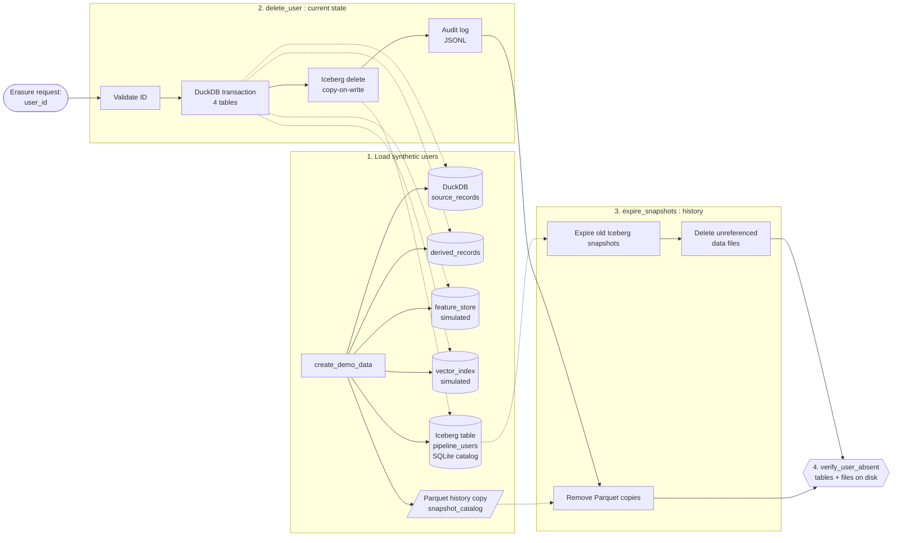

# Lakehouse Erasure Lab

A reproducible local prototype that shows what a user-erasure request has to touch in a lakehouse-style stack, and what is still on disk after a "successful" delete. Built with **DuckDB, Apache Iceberg (PyIceberg) and Parquet**, on synthetic data only.

**Headline result:** in all 20 measured runs, current-state deletion left **two physical copies** of the erased user on disk (a Parquet history copy and the superseded Iceberg data file) until a separate cleanup step removed them. Deleting rows is not the same as erasing data. Full write-up: [`reports/technical-report.pdf`](reports/technical-report.pdf).

> Educational prototype. Not a production erasure service and not evidence of GDPR/DPDP compliance. See [Limitations](#limitations).

## Architecture



The flow has two deliberately separate phases:

1. **Current-state deletion** removes the user from the four DuckDB tables (one transaction) and from the Iceberg table. Iceberg rewrites the data file, so the *old* file, which still contains the user, remains on disk.
2. **Historical cleanup** removes registered Parquet copies, expires old Iceberg snapshots and deletes the now-unreferenced data files.

DuckDB and Iceberg share no transaction. If Iceberg fails after DuckDB commits, the result reports `iceberg_error` and `verified_current_state: false`; nothing is rolled back or retried. More detail in [`docs/architecture.md`](docs/architecture.md).

## Quick start

Requires Python 3.10+ (tested on 3.12), and Git.

### One command (Linux/macOS)

```bash
./run_all.sh        # venv -> install -> tests -> demo -> benchmark -> executed notebook
```

or `make setup && source .venv/bin/activate && make all`.

### Step by step

```bash
python -m venv .venv
source .venv/bin/activate            # Windows CMD: .venv\Scripts\activate
python -m pip install --upgrade pip
pip install -r requirements.txt      # includes PyIceberg + SQLAlchemy, pinned

python -m pytest -q                  # 9 tests, ~5 s
python -m src.erasure.pipeline       # demo: erases U000007
python scripts/benchmark.py          # ~10 s, writes results/scale_benchmark.csv
python scripts/create_notebook.py    # (re)build the notebook
jupyter nbconvert --to notebook --execute --inplace notebooks/results.ipynb
```

Demo options: `python -m src.erasure.pipeline --users 5000 --user-id U000042`. The demo exits non-zero if the checked locations still contain the user.

### Docker Compose (not tested in the authoring environment)

```bash
docker compose up --build            # runs tests, demo and benchmark; results land in ./results
```

## What is in the repo

| Deliverable | Where |
|---|---|
| Architecture diagram + setup | this README, [`docs/architecture.md`](docs/architecture.md) |
| Reproducible pipeline | `src/erasure/`, `scripts/benchmark.py`, `run_all.sh`, `Makefile`, `Dockerfile`, `docker-compose.yml` |
| Results notebook (executed) | [`notebooks/results.ipynb`](notebooks/results.ipynb) |
| Technical report (4 pages) | [`reports/technical-report.pdf`](reports/technical-report.pdf) / [`.md`](reports/technical-report.md) |
| Data card | [`docs/data-card.md`](docs/data-card.md) |
| Tests | `tests/test_pipeline.py` |

```text
├── src/erasure/{pipeline.py, iceberg_store.py}
├── scripts/{benchmark.py, create_notebook.py}
├── tests/test_pipeline.py
├── notebooks/results.ipynb
├── docs/{architecture.md, data-card.md}
├── reports/{technical-report.md, technical-report.pdf}
├── results/{scale_benchmark.csv, benchmark_summary.csv, benchmark_environment.json, *.png}
├── data/{raw, processed}      # runtime state, git-ignored
├── requirements.txt  Makefile  run_all.sh  Dockerfile  docker-compose.yml
```

## Results

Five independent runs per size, synthetic data, one machine (1 CPU core, Python 3.12.3, DuckDB 1.1.3, PyIceberg 0.10.0). Regenerate with `python scripts/benchmark.py`.

| Users | Deletion mean (ms) | Median | Cleanup mean (ms) | Copies after delete → after cleanup | Verified |
|---:|---:|---:|---:|:---:|:---:|
| 100 | 58.5 | 54.8 | 31.6 | 2 → 0 | 5/5 |
| 1,000 | 56.9 | 56.3 | 30.5 | 2 → 0 | 5/5 |
| 5,000 | 78.5 | 63.6 | 34.8 | 2 → 0 | 5/5 |
| 10,000 | 84.8 | 80.1 | 53.9 | 2 → 0 | 5/5 |

Timings vary 20–30% between repeated benchmark runs on the same machine (a second full run gave 59–102 ms mean deletion); the verification outcomes and the 2 → 0 copy counts did not change. About 70% of deletion time is Iceberg; about 20% is the four-table DuckDB transaction. These are local prototype timings, not production performance, and your numbers will differ with hardware. Timings in earlier versions of this README (47–59 ms) came from a different, DuckDB-only benchmark and are not comparable.

## Limitations

This does **not** cover: backups and replicas, logs, caches, downstream consumers, real feature stores or vector databases, cloud object-storage versions, authentication/authorization, durable request tracking and retries, or concurrent readers and writers. The orphan-file cleanup only operates on this demo's dedicated Iceberg table and is unsafe as a general garbage collector. The audit log stores the user ID. Passing tests and verification establish behavior for the locations this code checks, nothing more.

## License

No license is included. Add one before publishing, plus any institutional attribution your course requires.
