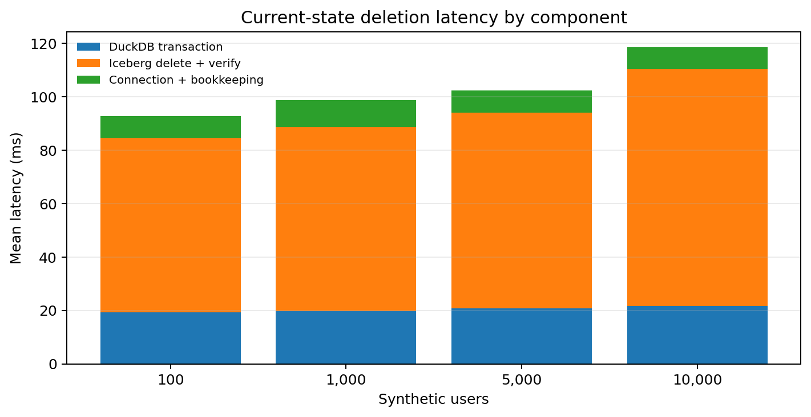

### The Right to Be Forgotten in a Lakehouse: Verifying Deletion Across DuckDB, Apache Iceberg, and Parquet

**DuckDB, Apache Iceberg and Parquet: what deletion verifiably removes, and what it leaves behind**

## Abstract

A user-erasure request has to reach more than the table a user was loaded into. Derived tables, features, embeddings, exported Parquet copies and table-format history can all still hold the same person's data. This project builds a reproducible local prototype using DuckDB, Apache Iceberg (SQLite catalog and local Parquet files), and Parquet exports, and measures it on synthetic data.

The central finding is that **a successful current-state delete is not, by itself, complete erasure**. In all 20 benchmark runs, deletion left two physical copies of the target user on disk: a Parquet history copy and the superseded Iceberg data file. A separate cleanup step removed those copies. In the latest executed notebook run, mean deletion latency ranged from **92.712 ms to 118.399 ms** across datasets of 100 to 10,000 users. Mean cleanup latency ranged from **68.066 ms to 80.532 ms**. All 20 runs passed deletion verification and all 20 passed post-cleanup verification. These are local prototype measurements, not production performance figures or evidence of legal compliance.

## 1. Problem

Analytical platforms fan data out: a source table feeds derived tables, features and embeddings, while snapshots and exports preserve earlier states. Deleting a row from the source does not automatically remove those other copies. Table formats add a subtler version of the same issue. Iceberg deletes by committing a new snapshot; older data files can remain on disk until old snapshots are expired and unreferenced files are removed.

The lab asks three questions:

1. Can one request remove a user from all simulated current-state stores and be checked afterwards?
2. How long does deletion take as the dataset grows, and which component dominates?
3. How many copies remain after deletion, and what removes them?

## 2. System

**Stores (all local).** Four DuckDB tables represent a source system and downstream copies: `source_records`, `derived_records`, `feature_store`, and `vector_index` (8-dimensional embeddings stored as JSON). A Parquet export of the source table, tracked in `snapshot_catalog`, represents a historical copy. A local Iceberg table, `erasure_lab.pipeline_users`, is held in a SQLite catalog with Parquet data files. The feature and vector stores are simulations; no external feature store or vector database is involved.

**Workflow.** `delete_user` validates the ID, counts the user's rows, deletes from the four DuckDB tables in one transaction, then deletes from Iceberg and appends an audit record. `expire_snapshots` removes registered Parquet copies, expires all but the latest Iceberg snapshot, and deletes data files in the pipeline table's directory that the current table state no longer references. `verify_user_absent` checks the four tables, registered Parquet copies, the Iceberg table state, and every Parquet file physically present in the Iceberg data directory.

**No cross-system atomicity.** DuckDB and Iceberg do not share a transaction. If Iceberg fails after DuckDB commits, the result carries the error and `verified_current_state` is false; the prototype does not roll back DuckDB or retry. A test injects this failure.

**Scope of cleanup.** Orphan-file removal is written for this single demo table. It is not a general garbage collector and would be unsafe against concurrent readers or writers.

## 3. Method

For each of four dataset sizes (100, 1,000, 5,000 and 10,000 synthetic users), the benchmark runs five independent cycles. Each cycle generates data, deletes one target user, measures residual physical copies, runs cleanup, and measures residual copies again. Each cycle uses a separate scratch directory. The notebook reports the benchmark CSV generated by `scripts/benchmark.py`.

Recorded metrics include:

- deletion latency, split into DuckDB and Iceberg sections;
- cleanup latency;
- physical copies of the target user outside active state, before and after cleanup;
- bytes of Parquet data reclaimed by cleanup.

A run counts as cleanup-verified only if no operation reported an error and zero physical copies of the target user remain in the locations checked by the prototype.

**Execution environment reported by the executed notebook:** Python 3.12.10, Windows 11, 12 CPUs, DuckDB 1.1.3, PyIceberg 0.10.0, PyArrow 17.0.0, pandas 2.2.3. Five repeats were run for each dataset size. The notebook metadata currently labels the kernel `.venv (3.13.13)`, which conflicts with the executed environment cell's Python 3.12.10. The runtime value is reported here because it is what the notebook printed during execution; confirm the selected kernel before a fresh reproduction.

## 4. Results

### 4.1 Correctness

The notebook reports **20/20 deletion verifications** and **20/20 cleanup verifications**. Every size has five successful deletion runs and five successful cleanup runs. The residual-copy count is two immediately after deletion and zero after cleanup.

### 4.2 Exposure window

| Users | Copies immediately after deletion | Copies after cleanup |
|---:|---:|---:|
| 100 | 2 | 0 |
| 1,000 | 2 | 0 |
| 5,000 | 2 | 0 |
| 10,000 | 2 | 0 |

The two copies are the Parquet history file and the pre-delete Iceberg data file. A query against current-state tables can show the user as absent while data remains recoverable from those physical files. The separate cleanup phase removes the copies checked by this prototype.

### 4.3 Latency

| Users | Deletion mean (ms) | Median (ms) | Min (ms) | Max (ms) | Cleanup mean (ms) |
|---:|---:|---:|---:|---:|---:|
| 100 | 92.712 | 85.838 | 83.753 | 118.248 | 69.005 |
| 1,000 | 98.744 | 92.956 | 85.141 | 124.788 | 80.532 |
| 5,000 | 102.252 | 107.375 | 82.288 | 118.639 | 69.430 |
| 10,000 | 118.399 | 100.146 | 91.606 | 175.909 | 68.066 |

The Iceberg component accounts for approximately **69.7%–75.1%** of mean deletion latency across the four dataset sizes (using the component means reported by the notebook). The benchmark shows a modest increase in mean deletion latency from 100 to 10,000 users, but the five-repeat sample is small and does not establish asymptotic scaling. At 10,000 users, the maximum deletion latency (175.909 ms) is noticeably above the median (100.146 ms), so the mean should be interpreted alongside the spread.



### 4.4 Storage reclaimed and illustrative cost

| Users | Mean Parquet data reclaimed | Estimated compute cost | Estimated monthly storage savings |
|---:|---:|---:|---:|
| 100 | 4.0 KiB | $0.000002 | $0.00000009 |
| 1,000 | 14.7 KiB | $0.000002 | $0.00000032 |
| 5,000 | 67.1 KiB | $0.000002 | $0.00000147 |
| 10,000 | 133.3 KiB | $0.000003 | $0.00000292 |

The notebook uses assumed rates of $0.05 per compute-hour and $0.023 per GB-month. The cost estimates are illustrative accounting outputs at a very small scale, not real cloud billing or a meaningful estimate of production savings.

## 5. Discussion

**Delete and erase are different operations.** The clearest result is the exposure window: current-state tables report the user as absent immediately after deletion, while two physical copies remain. The prototype therefore separates current-state deletion from historical cleanup and checks storage files directly.

**Verification must inspect storage, not just queries.** Table queries alone cannot detect every historical copy. Counting the target user's presence in files on disk makes the residual-copy window measurable and verifies that the cleanup phase removed the copies in scope.

**Cleanup has a defined boundary.** The prototype verifies the four DuckDB tables, registered Parquet snapshots, Iceberg table state, and Parquet files in the Iceberg data directory. It cannot prove that copies do not exist in unmodelled backups, replicas, logs, caches, exports, or external systems.

## 6. Limitations

- Data is synthetic and relatively small; measurements are from one Windows machine with five repeats per size.
- Feature and vector stores are DuckDB tables, not real external services.
- Backups, replicas, cloud object versions, logs, caches and downstream exports are not modelled.
- The audit log stores the user ID, which a real system would have to treat as personal data with its own retention rule.
- Deletion and cleanup run without competing readers or writers.
- Orphan-file cleanup is specific to the demo table and is not safe as a general concurrent garbage collector.
- Verification covers only the locations the code checks; it cannot prove that no other copy exists.
- This prototype is not a GDPR, DPDP or other legal-compliance demonstration.

## 7. Future work

Future work includes failure injection between phases, retries with stable request IDs, durable request tracking, lineage-driven propagation to derived data, real feature-store and vector-database targets, object-store versioning and backups, concurrency-safe cleanup using catalog maintenance procedures, and larger repeated runs on clearly specified hardware.

## References

1. Apache Iceberg, “Maintenance: Expire Snapshots.” https://iceberg.apache.org/docs/latest/maintenance/
2. Project implementation: `src/erasure/pipeline.py`, `src/erasure/iceberg_store.py`; benchmark: `scripts/benchmark.py`; results: `results/scale_benchmark.csv`, `notebooks/results.ipynb`.


## Appendix A. Physical file deletion evidence

The executed notebook's cleanup log records the following paths as deleted:

```text
[parquet_history_copy] data\\processed\\snapshots\\snapshot_d2d7194b520c.parquet
[iceberg_data_file] data\\iceberg_warehouse\\erasure_lab\\pipeline_users\\data\\00000-0-9abf10a7-fbeb-482f-8f00-30d3157d178b.parquet
[iceberg_data_file] data\\iceberg_warehouse\\erasure_lab\\pipeline_users\\data\\00000-0-f18b1279-5168-4c49-b262-733747cd547e.parquet
```

These are the paths printed by the demo cleanup run captured in `results/demo_output.txt`. They provide an example of the physical files removed in that run; the benchmark's aggregate residual-copy counts are reported separately above.
